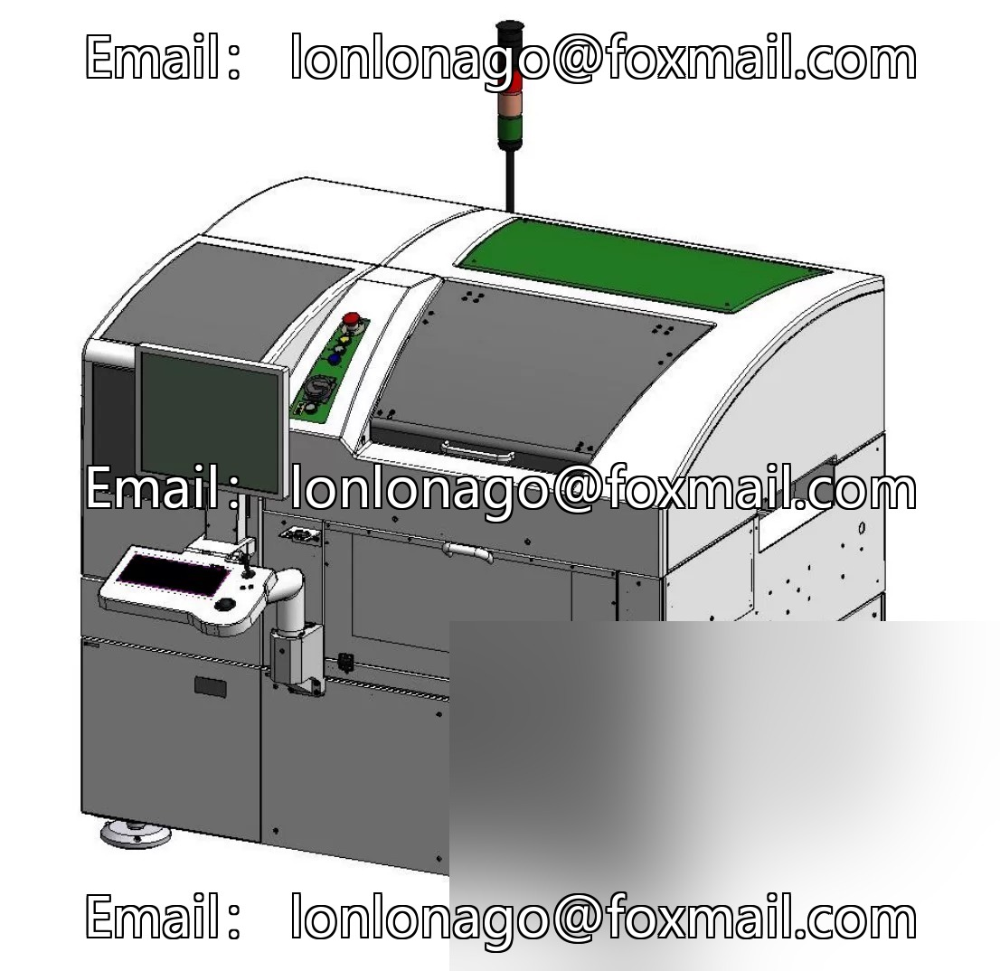
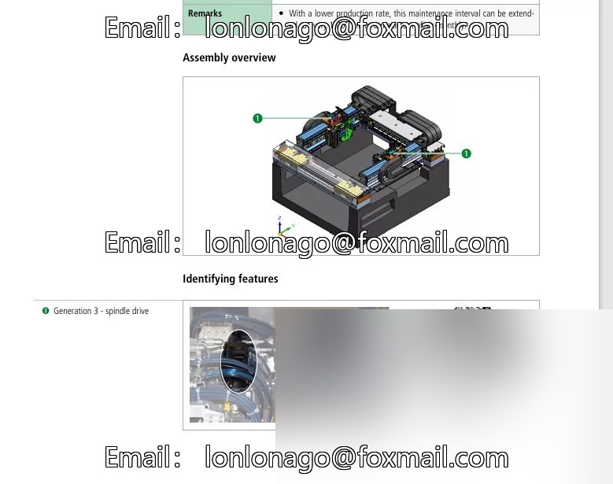
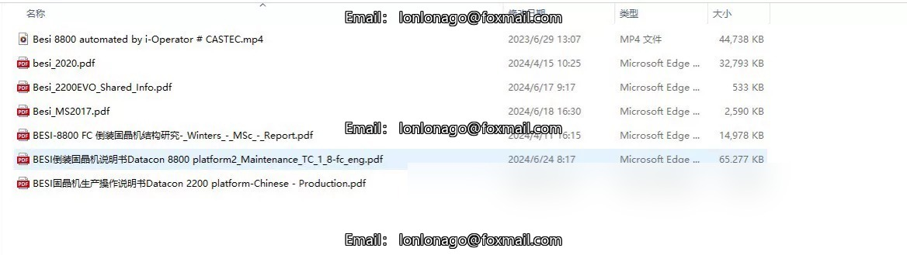
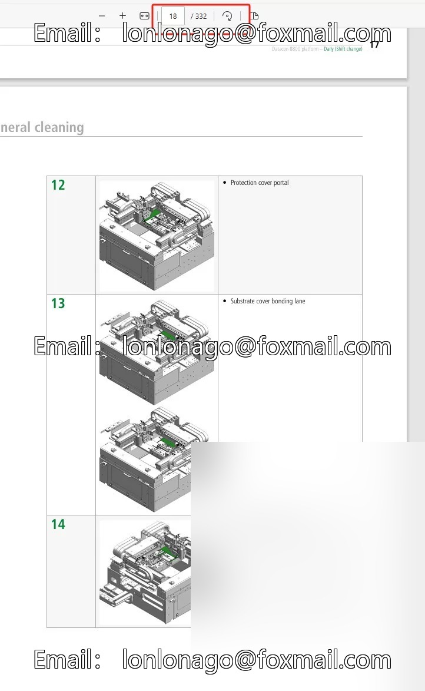
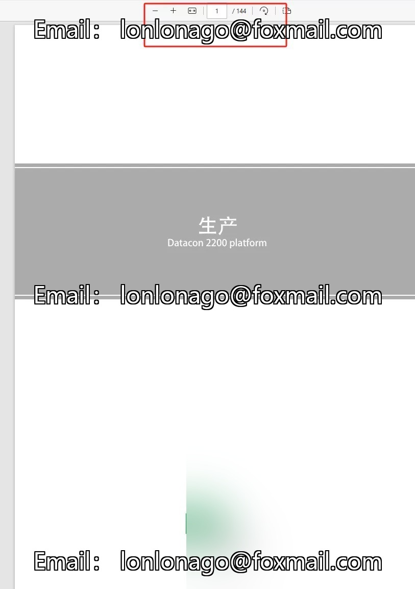
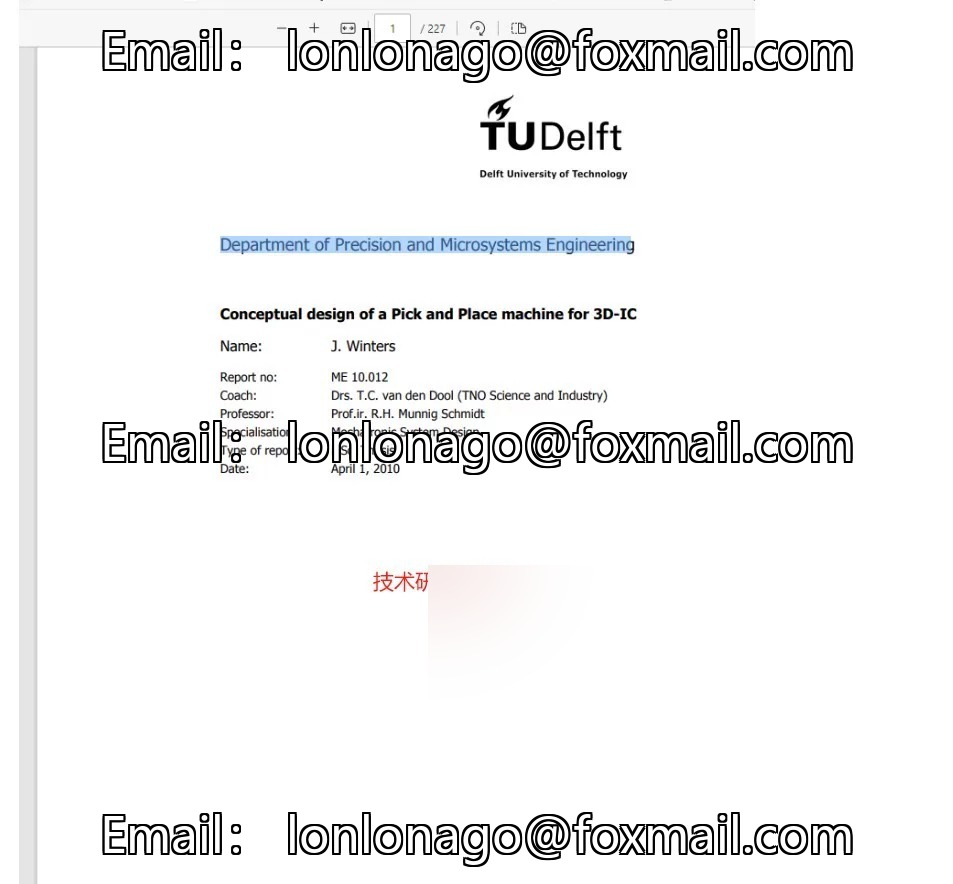
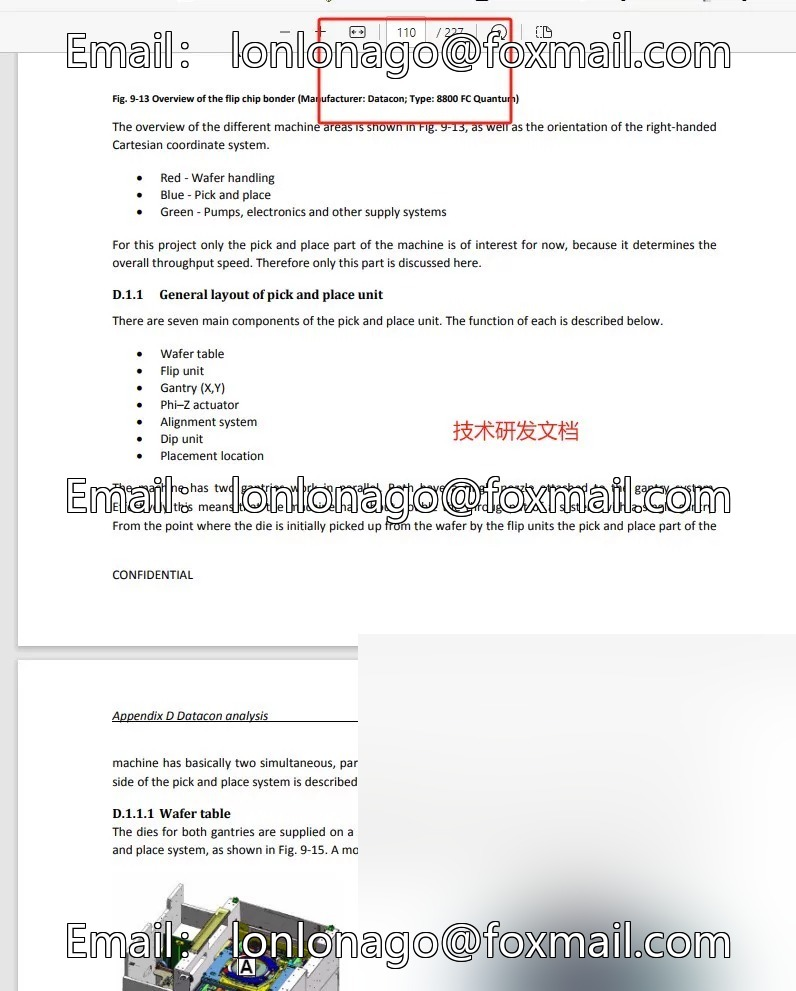
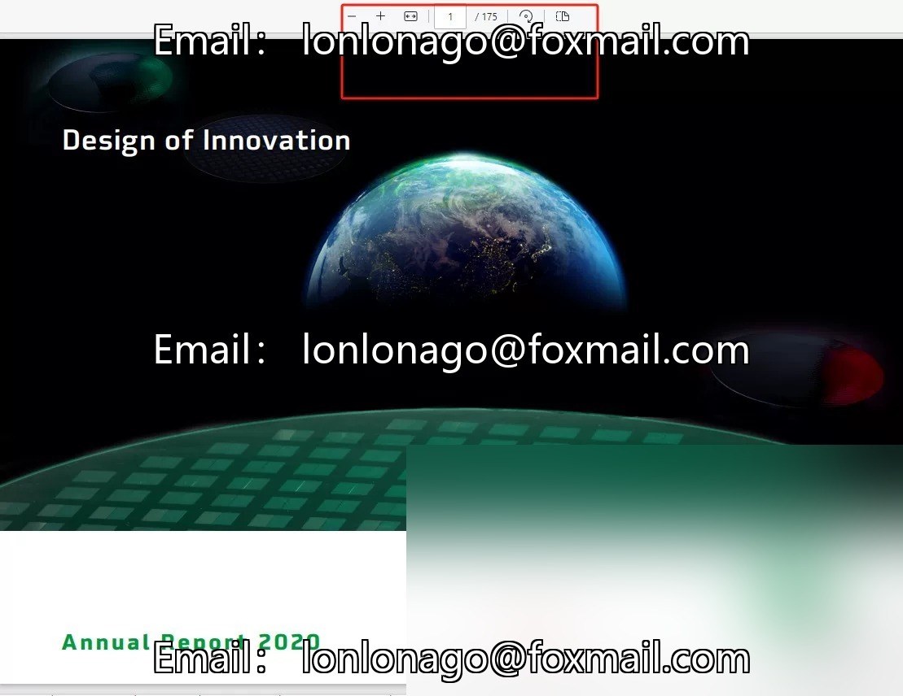

# BESI inversion solidification machine instruction manual Datacon 8800/ 2200

## Body

BESI invert crystallization machine manual, Datacon 8800/ 2200 and other data, including technical analysis documents, manual documents and videos, and relevant process documents (see catalog for details)

Purchasing BESI to provide some related technical materials

The specification documents contain various structural diagrams that can clearly show the overall structure of the entire equipment and are very valuable for research on the inverted solid-pillar machine!!

Take a photo and immediately send the electronic original file! The following image includes a file directory screenshot. Please confirm before placing an order! Due to the copyability of electronic file materials, So, after purchasing, returns are not allowed! Thank you for understanding!

The instruction materials cover BESI inverted-solid-crystallization machines, structural sketches, production operation and related process documents, plus videos; purchasing includes bonus technical materials, though price details are not specified in the description.

<!-- AI_ENRICHED -->

## Images

## Payment

Here is a pay link on Stripe ( https://buy.stripe.com/3cs8yP7sY87d0vu9AB ). Please contact me lonlonago@foxmail.com after funding $89, and I will send you a complete data files , thank you!

